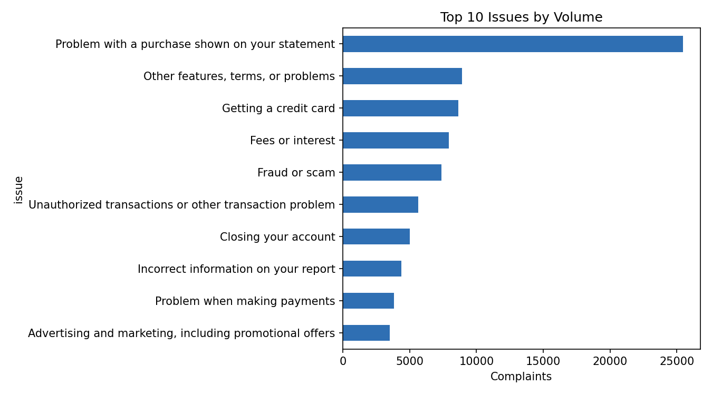
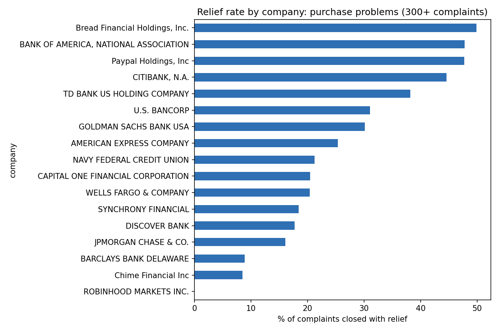

# Customer Complaint Analytics: Credit Card and Money Transfer (CFPB)

An end-to-end analysis of consumer complaints about credit cards and money transfer services, using SQL, Python, and a dashboard. The goal is to find what drives complaints, where outcomes are inconsistent, and which process changes to prioritize.

**Dashboard:** https://public.tableau.com/app/profile/kashish.tinguria/viz/CFPBComplaintAnalytics/ComplaintDashboard?publish=yes
**Insights memo:** [docs/insights_memo.md](docs/insights_memo.md)

## Business problem

A financial services firm wants to reduce complaint volume and improve how complaints are resolved. Which issues drive the most complaints, how consistent are outcomes for the same issue, and where do companies miss response deadlines?

## Data

- **Source:** [CFPB Consumer Complaint Database](https://www.consumerfinance.gov/data-research/consumer-complaints/)
- **Products:** Credit card; Money transfer, virtual currency, or money service
- **Size:** 99,944 complaints received between January and October 2026 (the first and last months are partial, so trend analysis uses February to September)
- **Note:** The raw data is not stored in this repo. To reproduce, download the filtered CSV from the CFPB site and save it as `data/complaints.csv`.

## Questions answered

1. Which issues generate the most complaints?
2. How has volume changed over time?
3. How often do companies respond late, and where is it concentrated?
4. How often do complaints end in relief for the consumer, and does it vary by issue and company?
5. Does the submission channel affect outcomes?

## Approach

1. **Load and clean (SQL, Python):** imported the CSV into SQLite and built a cleaned table with derived fields: `year_month`, `days_to_company`, `is_timely`, and `got_relief` (closed with monetary or non-monetary relief).
2. **Explore (SQL):** volume by issue, month-over-month trend using window functions, late-response and relief rates by issue and company.
3. **Deep dive (SQL):** compared companies within the same issue, so differences in issue mix don't distort the comparison.
4. **Visualize (Python):** four charts in `docs/charts/`.
5. **Dashboard:** interactive version of the findings.
6. **Recommend:** insights memo with prioritized actions and KPIs.

## Key findings

- **One issue dominates.** "Problem with a purchase shown on your statement" is 25.5% of all complaints (25,477).
- **Outcomes for the same issue vary widely.** For purchase problems, relief rates range from about 50% at some large companies to under 10% at others.
- **Fraud or scam complaints rarely end in relief.** The overall relief rate is 11.0%, compared with 22.4% across all complaints, and ranges from 43% to 0% by company.
- **Late responses are rare but concentrated.** About 1.5% of responses were late, and three companies account for 57% of them.
- **Channel and volume are not drivers.** Relief rates are about 21% to 23% across channels, and monthly volume is stable from February to September.

See the [insights memo](docs/insights_memo.md) for details, recommendations, and KPIs.




## Limitations

- Complaints are unverified consumer submissions, not confirmed incidents.
- "Closed with relief" is not a measure of fairness. For example, closing a fraud complaint with an explanation can be appropriate when the transaction was authorized.
- Complaint counts are not adjusted for company size, so volume alone doesn't rank companies.
- The dataset has no resolution date and no complaint narrative, so resolution time and text-theme analysis are out of scope. `days_to_company` measures only the delay before a complaint is sent to the company.
- Small companies have unstable rates, so company comparisons use minimum complaint counts.

## How to reproduce

```bash
pip install pandas matplotlib
python load_data.py                              # load CSV into data/complaints.db
sqlite3 data/complaints.db < sql/01_clean.sql    # build the cleaned table
sqlite3 -header -column data/complaints.db < sql/02_explore.sql
python analysis.py                               # charts in docs/charts/
```

## Repo structure

```
data/         raw data and database (not committed)
sql/          cleaning and analysis queries
notebooks/    exploratory notebooks
dashboard/    dashboard files and screenshots
docs/         insights memo and charts
load_data.py  loads the CSV into SQLite
analysis.py   builds the charts
```

## Tools

SQL (SQLite), Python (pandas, matplotlib), Tableau Public, Git/GitHub
