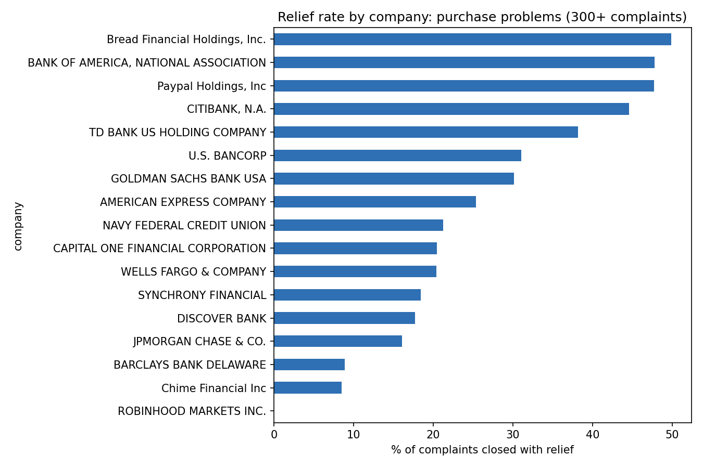
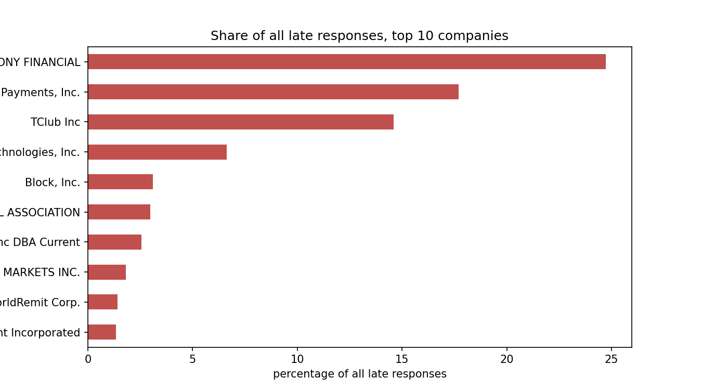

# Insights Memo: Credit Card and Money Transfer Complaints

**Prepared by:** Kashish
**Date:** November 2026
**Data:** 99,944 CFPB consumer complaints (credit card; money transfer, virtual currency, or money service), received January to October 2026

## Purpose

Identify what drives consumer complaints, where outcomes are inconsistent, and which process changes to prioritize.

## Summary

Complaint volume is steady, so the opportunity is in how complaints are handled, not in a growing trend. Three things stand out: one issue accounts for a quarter of all complaints, outcomes for the same issue differ sharply between companies, and late responses come from a handful of firms.

## Findings

### 1. Purchase disputes are the largest driver, and handling is inconsistent

"Problem with a purchase shown on your statement" accounts for 25,477 complaints, or 25.5% of the total, more than double the next issue. Among companies with at least 300 of these complaints, the share closed with relief ranges from about 50% (Bread Financial 49.9%, Bank of America 47.8%, PayPal 47.7%, Citibank 44.6%) down to 8.9% (Barclays), 8.5% (Chime), and 0.0% (Robinhood). Capital One, with 3,748 of these complaints, is at 20.5%.

Because the comparison is within one issue, issue mix doesn't explain the gap. A spread of this size suggests inconsistent dispute decisions.

### 2. Fraud and scam complaints rarely end in relief, and results vary by company

Fraud or scam is the largest money transfer issue (7,372 complaints, 7.4% of the total). Its relief rate is 11.0%, against 22.4% across all complaints. By company, PayPal closes 43.1% of 1,196 complaints with relief, while Block closes 0.0% of 1,845 (about a quarter of all fraud complaints in the data). Early Warning Services is at 0.0%, Chime at 1.1%, and JPMorgan Chase at 4.3%.

This is not proof of poor service. Closing a complaint with an explanation can be correct when the consumer authorized the payment. It does show a large gap that deserves a closer look by scam type.

### 3. Late responses are rare but concentrated

About 1.5% of responses were late (roughly 1,480 complaints). Three companies account for 57% of them: Synchrony Financial (24.7%), Imprint Payments (17.7%), and TClub (14.6%). Adding Bilt Technologies brings it to about 64%.

The issue "Money was not available when promised" has an 11.8% late rate, far above any other, but it is mostly one company: TClub answered 140 of its 165 complaints on this issue late.

### 4. Volume and channel are not drivers

Monthly volume is stable from February to September, at roughly 10,000 to 11,400 complaints. January and October are partial months and should not be read as trends. Web accounts for 93% of complaints, and relief rates are about 21% to 23% across all channels.

## Recommendations

| Priority | Recommendation | Why | KPI to track |
|---|---|---|---|
| 1 | Standardize purchase-dispute handling: document decision criteria and an evidence checklist, benchmark against high-relief peers, and add quality sampling of closed disputes | Largest issue (25.5%), with a gap of about 40 points between companies | Relief rate and its spread by company; repeat-complaint rate |
| 2 | Review fraud and scam closures by scam type, checking that "closed with explanation" decisions are consistent and meet requirements for unauthorized transactions | Relief is 11.0% overall and 0% at some companies | Relief rate by sub-issue; share of fraud complaints closed with explanation |
| 3 | Add response-deadline monitoring with early warnings and escalation for the few companies driving late responses | Three companies account for 57% of late responses | Timely-response rate (target 99.5% or higher); late count by company |

## Limitations and next steps

- Complaints are unverified consumer submissions, and counts are not adjusted for customer base size.
- "Relief" is a proxy for outcome, not a measure of whether the outcome was fair.
- The data has no resolution date or complaint narrative, so resolution time and text themes are not covered.
- Next steps: split fraud complaints by sub-issue, check whether the pattern persists in other months, and add narrative analysis if text data becomes available.
